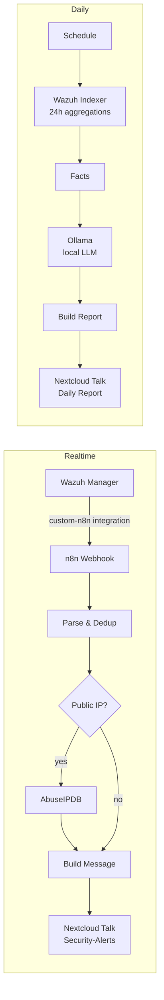

# Wazuh → n8n → Nextcloud Talk

Turn noisy [Wazuh](https://wazuh.com) alerts into actionable chat messages in [Nextcloud Talk](https://nextcloud.com/talk/), orchestrated with [n8n](https://n8n.io) — plus a daily security report written by a **local LLM** (Ollama), so no log data ever leaves your network.

## Features

**Real-time alerts** (`workflows/wazuh-realtime-alerts.json`)

- Forwards Wazuh alerts above a configurable level to a Talk conversation
- Deduplication with configurable time windows (global and per rule) and a counter of suppressed duplicates
- Rich messages: what happened, affected agent, source/attacker IP, acting and target account, MITRE ATT&CK technique, Windows event ID, local time
- Optional IP reputation check via [AbuseIPDB](https://www.abuseipdb.com) (public IPs only — internal IPs are never sent out)
- Escalation to 🔴 *critical* by Wazuh level or AbuseIPDB score

**Daily report** (`workflows/wazuh-daily-report-llm.json`)

- Runs on a schedule and queries the Wazuh Indexer (OpenSearch) for the last 24 h
- Covers **all** alerts, including low-level and deduplicated ones
- Hard numbers (totals, severity breakdown, top rules, top agents, external IPs, off-hours activity) are computed in code — never by the LLM
- A local LLM via Ollama adds an analysis: overall status, critical events, patterns, recommendations and rule-tuning candidates
- Graceful fallback: if the LLM is unreachable, the statistics are sent anyway

## Architecture



## Repository structure

```
.
├── workflows/
│   ├── wazuh-realtime-alerts.json     # n8n workflow: real-time alerts
│   └── wazuh-daily-report-llm.json    # n8n workflow: daily LLM report
└── wazuh-integration/
    ├── custom-n8n.py                  # Wazuh integration script
    ├── ossec-integration.xml          # snippet for the Wazuh manager config
    └── setup-n8n-ca.sh                # helper for self-signed n8n certificates (Docker)
```

## Requirements

- Wazuh 4.x (tested with the official Docker single-node deployment)
- n8n (recent version; note that newer versions use **Publish** instead of an *Active* toggle)
- Nextcloud with Talk
- Optional: an AbuseIPDB API key (free tier is sufficient)
- Optional (daily report): Ollama reachable from n8n

## Setup

### 1. Nextcloud Talk

1. Create a dedicated user, e.g. `wazuh-bot`, and an **app password** for it (*Settings → Security*).
2. Create a conversation (e.g. *Security-Alerts*) and add the bot user as a participant.
3. Copy the conversation token from the URL: `https://NEXTCLOUD-HOST/call/<TOKEN>`.
4. Test:

```bash
curl -u "wazuh-bot:APP-PASSWORD" \
  -H "OCS-APIRequest: true" -H "Content-Type: application/json" -H "Accept: application/json" \
  -X POST "https://NEXTCLOUD-HOST/ocs/v2.php/apps/spreed/api/v1/chat/<TOKEN>" \
  -d '{"message":"Hello from n8n"}'
```

HTTP `201` means success. Note the API path `/ocs/v2.php/...` — the web URL `/call/<TOKEN>` will not work.

### 2. n8n: real-time alerts workflow

1. Import `workflows/wazuh-realtime-alerts.json`.
2. Create credentials:

   | Node | Credential type | Values |
   |---|---|---|
   | Wazuh Webhook | Header Auth | Name `X-Wazuh-Token`, Value: a random secret (`openssl rand -hex 32`) |
   | AbuseIPDB Check | Header Auth | Name `Key`, Value: AbuseIPDB API key |
   | Send to Nextcloud Talk | Basic Auth | `wazuh-bot` + app password |

   Use **separate** credentials for each node. Selecting an existing credential and editing it with the pencil icon changes it for every node that uses it.
3. In *Send to Nextcloud Talk*, replace `NEXTCLOUD-HOST` and `TALK_ROOM_TOKEN` in the URL.
4. No AbuseIPDB key yet? Select the node and press `D` to deactivate it — the workflow still works.
5. Save and **Publish**. Production URL: `https://N8N-HOST/webhook/wazuh-alerts`.

### 3. Wazuh integration

Copy the script into the manager (Docker example):

```bash
C=single-node-wazuh.manager-1
sudo docker cp wazuh-integration/custom-n8n.py $C:/var/ossec/integrations/custom-n8n.py
sudo docker exec $C bash -c "cd /var/ossec/integrations && cp slack custom-n8n && \
  chown root:wazuh custom-n8n custom-n8n.py && chmod 750 custom-n8n custom-n8n.py"
```

- Set `TOKEN` in `custom-n8n.py` to the same secret as the n8n Header Auth credential.
- Add the block from `wazuh-integration/ossec-integration.xml` to the manager configuration. With Docker, edit `config/wazuh_cluster/wazuh_manager.conf` on the host — changes made in the dashboard may be overwritten when the container is recreated.
- Restart: `sudo docker compose restart wazuh.manager`
- Verify: `sudo docker exec $C grep -i integratord /var/ossec/logs/ossec.log | tail`

**Self-signed certificate on n8n?** Run the helper, which fetches the certificate, validates it, installs it into the container and tests the connection with the real token:

```bash
sudo N8N_HOST=n8n.example.com bash wazuh-integration/setup-n8n-ca.sh
```

### 4. Daily report (optional)

1. **Read-only Indexer user** — in the Wazuh dashboard under *Indexer management → Security*, or via *Dev Tools*:

```
PUT _plugins/_security/api/roles/n8n_alerts_read
{ "cluster_permissions": ["cluster_composite_ops_ro"],
  "index_permissions": [{ "index_patterns": ["wazuh-alerts-*"], "allowed_actions": ["read"] }] }

PUT _plugins/_security/api/internalusers/n8n-reader
{ "password": "CHANGE-ME" }

PUT _plugins/_security/api/rolesmapping/n8n_alerts_read
{ "users": ["n8n-reader"] }
```

2. **Ollama** must listen on an address reachable from n8n (`OLLAMA_HOST=0.0.0.0:11434`). Get the exact model name with `curl http://OLLAMA-HOST:11434/api/tags`.
3. Import `workflows/wazuh-daily-report-llm.json` and edit the node **Einstellungen** (settings):

```javascript
indexer_url: 'https://WAZUH-INDEXER-HOST:9200',
ollama_url:  'http://DGX-HOST:11434',   // no /v1 — the workflow uses /api/chat
model:       'MODELLNAME',              // exact name from /api/tags
```

4. Credentials: Basic Auth with `n8n-reader` for the Indexer node; the Talk credential for the last node. Make sure *Send Headers* with `OCS-APIRequest: true` stays enabled.
5. Run once with **Execute Workflow**, then **Publish**.

## Configuration

**Real-time alerts** — top of the node *Parse & Dedup*:

| Setting | Default | Meaning |
|---|---|---|
| `MIN_LEVEL` | `10` | Minimum Wazuh rule level |
| `DEFAULT_WINDOW_MIN` | `60` | Identical alerts (rule + agent + IP) are suppressed for this many minutes |
| `RULE_WINDOW_MIN` | `{'60602': 720}` | Per-rule suppression windows |
| `IGNORE_RULES` | `[]` | Rule IDs that are never reported |

**Daily report** — node *Einstellungen*: `hours`, `work_start`, `work_end` (for off-hours statistics). The schedule is set in the trigger node; the workflow time zone is `Europe/Berlin` (adjust in workflow settings).

> In recent n8n versions, changes only take effect on the production webhook after you **Publish** again.

## Example output

```
🔴 CRITICAL — Wazuh Level 12
Regel: Administrators Group Changed (60154)
Was ist passiert: A member was added to a security-enabled local group.
Agent: SRV-01 (10.0.0.10)
Ausgeführt von: DOMAIN\admin
Betroffenes Konto/Gruppe: Administrators
MITRE ATT&CK: T1484 Domain Policy Modification — Privilege Escalation
Event-ID: 4732
Zeit: 5.10.2026, 08:53:56
```

Message texts and the LLM prompt are in German; translate the strings in the *Build Message*, *Fakten aufbereiten* and *Bericht bauen* nodes if needed.

## Security notes

- **Prompt injection:** log fields (user names, URLs, user agents) can be attacker-controlled. The workflow passes them to the LLM explicitly as untrusted data, and the LLM output is only ever *displayed*. Never let LLM output trigger automated actions such as firewall blocks.
- **Least privilege:** use a dedicated read-only Indexer user and a dedicated Nextcloud bot account with an app password.
- **Webhook secret:** the webhook is protected by a shared header token; restrict network access to the n8n webhook (e.g. allow only the Wazuh manager).
- **TLS:** the Indexer node uses *Ignore SSL Issues* for self-signed certificates. Prefer a proper certificate or trust the CA via `NODE_EXTRA_CA_CERTS` in production.
- **Data protection:** AbuseIPDB only receives public source IPs. Alerts contain personal data (user names) — document the processing according to your local regulations (e.g. GDPR).
- **Before publishing your own exports:** n8n exports can contain real URLs, credential names and *pinned data* with real alerts. Review them before committing.

## Troubleshooting

| Symptom | Cause / fix |
|---|---|
| `File not found inside 'integrations'` | Wrapper `custom-n8n` (without extension) missing — `cp slack custom-n8n` |
| `CERTIFICATE_VERIFY_FAILED` | Self-signed n8n certificate — run `setup-n8n-ca.sh` |
| Webhook returns `404` | Workflow not published, or wrong path |
| Webhook returns `403` | Token in `custom-n8n.py` differs from the n8n credential |
| Talk: `CSRF check failed` | Header `OCS-APIRequest: true` missing |
| Talk returns HTML instead of JSON | Web URL used instead of `/ocs/v2.php/apps/spreed/api/v1/chat/<TOKEN>` |
| Talk `404` | Bot user is not a participant, or wrong token |
| `Could not resolve host: https` | Invisible characters from copy & paste — retype the command or strip them with `LC_ALL=C sed -i 's/[^[:print:]\t]//g' FILE` |
| Report says *KI-Analyse nicht verfügbar* | Check `ollama_url` (host:port, no `/v1`), the model name and network access from n8n to Ollama |

## License

[MIT](LICENSE)
